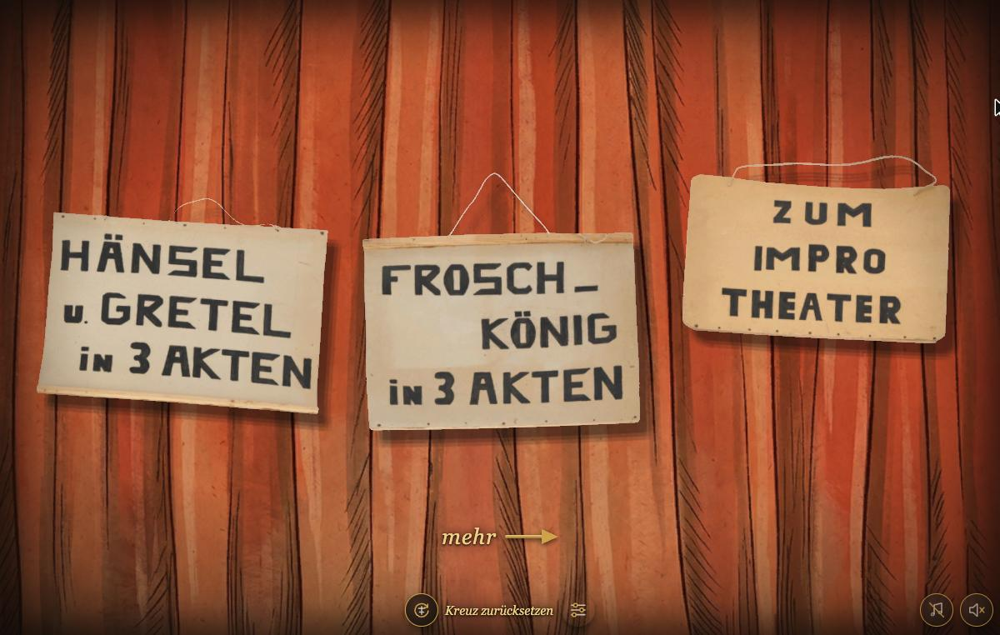
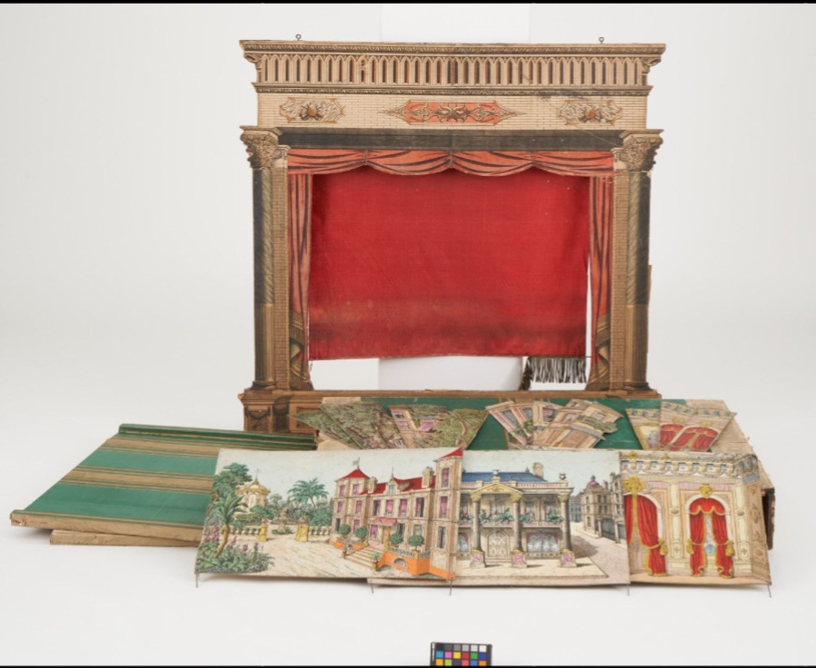
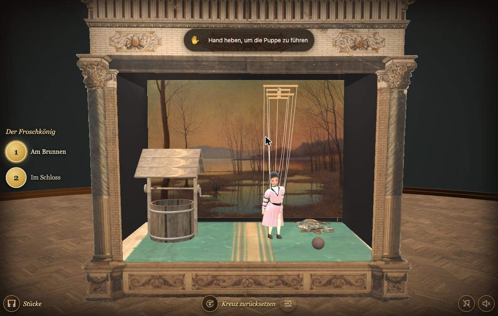
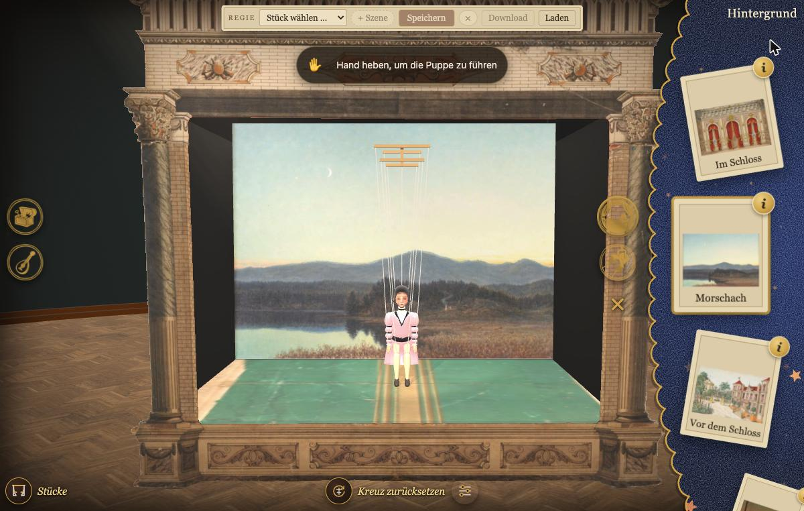
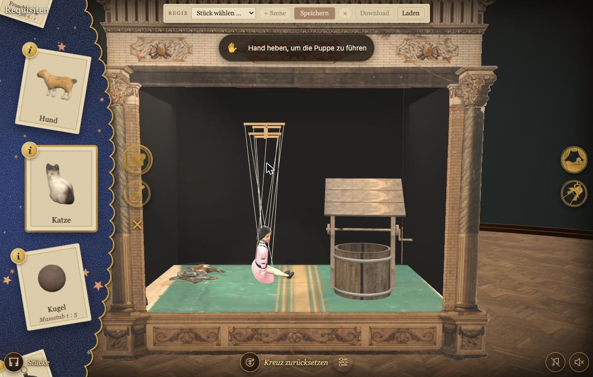
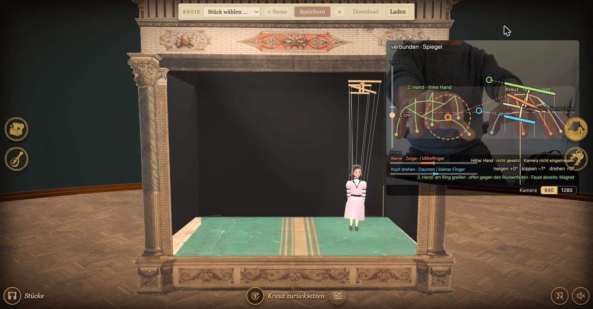
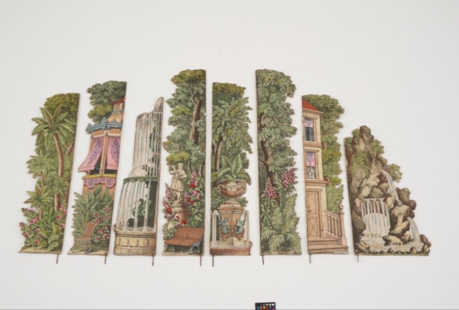

# Marionette Theatre, back in 3D

An interactive paper theatre in the browser, built from the SKKG collection: pick a play, set the stage with painted backdrops and digitised collection objects, and play a rigged SKKG marionette with your hand in front of the webcam.

**[Try it](https://glamhack26-theatre.github.io/puppetshow/)** (desktop with a webcam) · [GLAMhack 2026 project page](https://hack.glam.opendata.ch/project/334)



## The idea

The SKKG collection holds beautifully illustrated paper sheets that fold into a 3D puppet theatre stage, plus marionettes, small figures and stage objects. In the digital collection all of this exists only as photographs, so the theatre is flat again.



The challenge asked: *How can we bring the Marionette Paper Theatre back into three-dimensional space, and what can people experience in it?* It suggested several directions (a VR walk-through, an AR stage on a table, a build-it-yourself kit, a printable PDF) and left the format open.

**What we built:** an interactive 3D theatre in the browser. The visitor picks a play or sets up the stage with painted backdrops and stage objects digitised from the SKKG collection; objects from other collections come in through IIIF manifests. Then they play a rigged SKKG marionette on its real 9-string control cross with their hand.

## What you can do

1. **Choose a play.** A red curtain fills the screen and the play signs drop in front of it: *Hänsel und Gretel*, *Froschkönig* and *Impro*. Plays made in the app get their own signs (the *mehr* arrow shows the next row). A click raises the curtain and starts the webcam.
2. **Play the marionette.** Raise your hand in front of the camera; the marionette follows it on its strings, lit by its own follow spot. Without a camera the mouse moves the cross.
3. **Follow a play.** A play is a list of scenes. The gold medallions on the left (or the keys 1–9) change the scene: the stage curtain comes down, the set changes behind it, and it goes up again.

   

4. **Set your own stage (Impro).** Round buttons at the screen edges open paper-theatre panels:
   - **Hintergrund** (right): painted backdrops as cards; a click lets one down like a sheet from the fly loft.
   - **Requisiten** (left): stage objects; a click lowers one onto a free spot. Objects can be dragged across the floor, they collide, and the marionette can pick up small ones. The last card takes a **IIIF 3D manifest** (file or link): the object becomes a new stage object.
   - **Licht** (right): the light desk with lighting scenes.
   - **Sound** (left): sound-art excerpts to play.
   - The **Regie** bar at the top saves the stage as scenes of a new play (the deployed version downloads the play as a file).

   

   

5. **Check the source.** Every card has an **i** that opens the object in the SKKG collection. Objects invented with AI say so instead (*Fake-Objekt gefunden!*).
6. **Sound.** Two buttons at the bottom right switch background music and sound effects on; both are off when the page loads. Clicking a play sign turns them on.

## Playing with your hand

The first hand in front of the camera holds the cross; a second hand helps, as on a real marionette cross. The hand window (top right) shows what the camera sees: both hands, and the cross lying in the cross hand.



| Hand | What it does |
|---|---|
| Move the cross hand | The puppet moves left, right, up and down; towards the camera and back for depth |
| Tilt or turn the cross hand | The cross tilts: the puppet bows, leans or turns |
| Index and middle finger, alternately | The leg bar rocks: the puppet walks |
| Thumb or little finger | The head turns to that side |
| Lower the hand | The strings go slack: the puppet sits or lies down |
| Take the hand out of the picture | The puppet is let go; raise a hand again to take it |
| Second hand: pinch or fist at a bar's handle | Takes the hand bar, head bar or leg bar off the cross and moves it |
| Second hand: fist away from the handles | The puppet's hands grab like magnets |
| Second hand: a quick fist and open again | The puppet lets go of what it holds |

**Kreuz zurücksetzen** (bottom centre) puts the cross right again; the button next to it opens sliders for the puppet's standing height, the tilt of the cross and the string length.

**Keys:** Shift+P presentation · Shift+D debug buttons and panel · 1–9 scenes of a running play.

## Collection objects

All objects existed only as one or two photos in the SKKG digital collection (CC0). Each was rebuilt as a textured 3D model with Blender scripts and image processing (Python, OpenCV); the method depends on the object's shape.

- Stage and backdrops: [Theaterbühne 30717.1](https://digital.skkg.ch/de/intro/skkg%3Aobject%2F75eef8be-9ba0-4361-b986-6d2a445625e6)
- Sign: [Schild 45567.3](https://digital.skkg.ch/de/filter/skkg%3Aobject%2Fe811c87f-cd55-4b52-9a7d-104115f2fb34?skkgapi:object_genres=skkg:type/21087/140189)
- Marionette: [Marionettenpuppe 46154](https://digital.skkg.ch/de/intro/skkg%3Aobject%2F96da4bbf-e5b0-4a6f-a901-0736d225c13d) ([how the model was built](docs/marionette-model.md))
- Chest: [Truhe 46955](https://digital.skkg.ch/de/intro/skkg%3Aobject%2Fb31b189c-5e0e-4758-a323-27316d7b4d2c)
- Chair: [Stuhl 25210.6](https://digital.skkg.ch/de/intro/skkg%3Aobject%2F1470b11c-4fa7-4f3e-bc87-3ab883254ef4)
- Ball: [Kanonenkugel 38896.3](https://digital.skkg.ch/de/intro/skkg%3Aobject%2F65c920cd-2c29-4f67-b733-fd6a4ccd6b58)
- Bed: [Bett 44012](https://digital.skkg.ch/de/intro/skkg%3Aobject%2Fe338e1da-faf7-4b55-ace9-e6687bc5a0e5)
- Cup: [Becher 48468.21](https://digital.skkg.ch/de/intro/skkg%3Aobject%2F3733e0eb-dc2a-41dd-8a85-1da14200b6b5)
- Cat: [Katze «Villa Poupée» 29404.202](https://digital.skkg.ch/de/intro/skkg%3Aobject%2Fa7a830f4-e8ff-4971-9050-9da1b69c52fa)
- Frog: [1 Paar Tierfiguren; Frosch 49790](https://digital.skkg.ch/de/intro/skkg%3Aobject%2F81b996fe-be29-453f-a009-23f72ac49e94)
- Dog: [Krippenfigur Hund 38872.24](https://digital.skkg.ch/de/intro/skkg%3Aobject%2F5f99eeb6-fb56-43e3-a9d1-d54b6816493e)
- Tree: [Nadelbaum 29319.27](https://digital.skkg.ch/de/intro/skkg%3Aobject%2Ff936b13d-8a56-4fdb-b1aa-43044e78e3e8) (in the praline box of the presentation)
- Invented with AI, without an SKKG original: fountain, lantern, frog king

From another collection, through IIIF: [Mikroskop ETHZ GEOB 0055](https://sketchfab.com/3d-models/eth-microscop-1908-70d8dc2ff7b74b8e937bfc1350ca996d), ETH Library ([IIIF manifest](https://s3.dribdat.cc/glam/c/11615/40Y66/6G9RPV7U.json)).



**Limits of the 3D models**
- Sides not visible in any photo are plausibly completed, not documented: filled from the opposite side, a symmetric counterpart or a mirrored copy.
- Remnants of the photo background are retouched out.
- Fine relief such as needles, fingers or carving marks is mostly texture, not geometry.
- Large parts of the code, the Blender scripts and the 3D models were made with an AI coding assistant (Claude Code), guided and checked by the team. Each model was reimported, rendered and compared with the photo after every change.

## Run it yourself

You need [Node.js](https://nodejs.org) 22 or newer (the deploy uses 24). Once, after cloning:

```sh
npm install

./scripts/fetch-mediapipe-models.sh
```

Then start it:

```sh
npm run dev:https
```

Open [https://localhost:5173](https://localhost:5173), or `https://<your-IP>:5173` on a phone or another computer in the same network, and accept the certificate warning once.

## How it is built

| Topic | Decision |
|---|---|
| Engine | Meta IWSDK (three.js, ECS) in browser mode; WebXR possible later |
| Physics | Rapier: ragdoll, 9 rope-joint strings, grabbing, colliding stage objects |
| Input | MediaPipe hand tracking with one or two hands, mouse as fallback; all sources write one `ControlInput` |
| Stage light | A rig of five light groups on dimmers, designed with a theatre lighting expert, switched by lighting scenes; a follow spot per puppet |
| Plays | One JSON file per play in `assets/plays/`, written from the app (Regie bar) |
| Catalogue | `assets/catalogue.json`: label, scale and collection link for every stage object and backdrop |
| Sound | Music and excerpts streamed from archive.org, CC0 sound effects, physics sounds |
| Tooling | TypeScript, Vite; deployed to GitHub Pages |

More in [docs/](docs/): [architecture and decisions](docs/architecture.md) · [stage lighting](docs/lighting.md) · [marionette model](docs/marionette-model.md) · [play-test report on the hand control](docs/puppets.md) · [software bill of materials](SBOM.md)

## Team

- **Katja Rempel:** stage, curtain, signs, backdrop and stage-object sliders, catalogue, IIIF workflow in the app, UI for sound and light
- **Kai Jauslin:** rigged SKKG marionette model with control cross, follow spots, camera start on the sign click, fist gesture to let go
- **Cahit Atilgan:** architecture, project setup, phase 0 spike, Rapier, MediaPipe, presentation mode, background music, debug mode
- **Rita Gautschy:** 3D models of SKKG collection objects, fountain and praline box, IIIF 3D manifests, documentation
- **Sonja Gasser:** selection of SKKG objects and of audio files
- **Christiane Sibille:** expertise in hand puppet movements, testing movements of the marionette
- **Sandra Becker:** animated GIFs of objects in the scene

## Licences

- **Code:** [MIT](LICENSE)
- **SKKG photos:** CC0, [SKKG digital collection](https://digital.skkg.ch)
- **Music and sound-art excerpts:** streamed from archive.org under their netlabel licences (CC BY-NC-SA / CC BY-NC-ND), credited in the app while they play
- **Sound effects:** CC0 (Kenney, rubberduck, via OpenGameArt)
- **Fonts:** Geist and Geist Serif, SIL Open Font License

All dependencies and their licences: [SBOM.md](SBOM.md).
